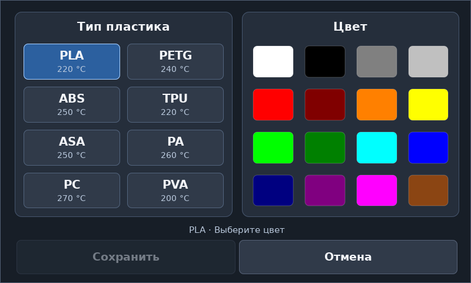
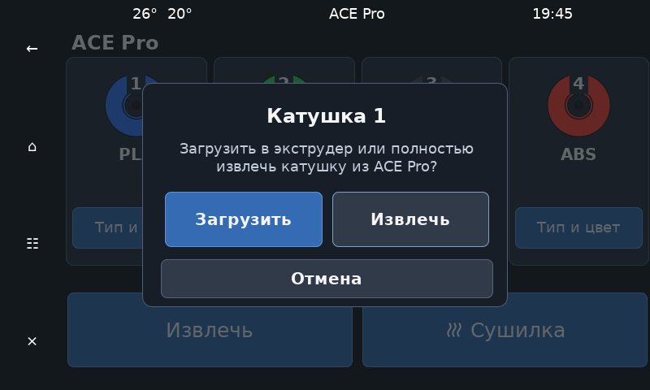
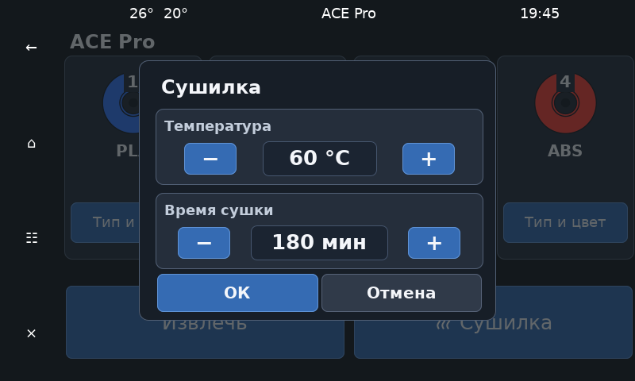
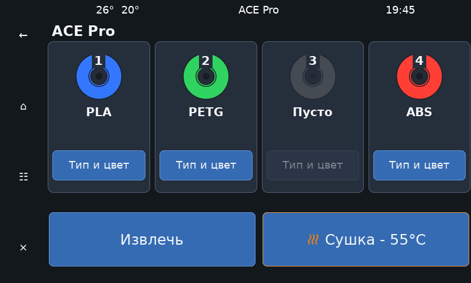
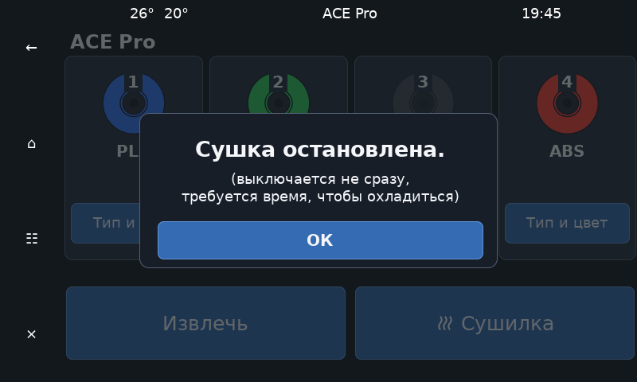
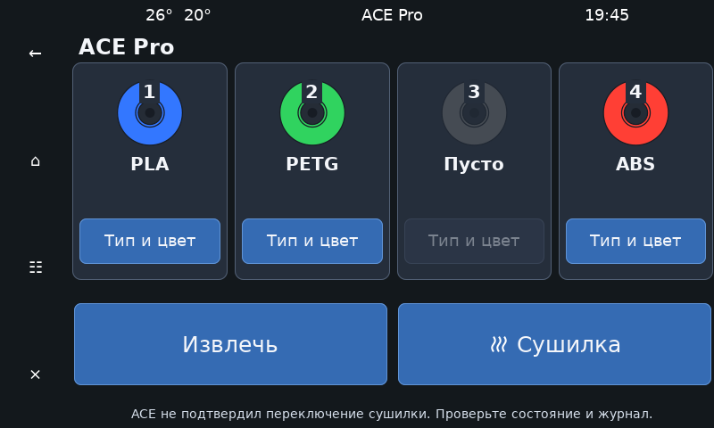

# AceScreen

**Визуальный интерфейс для Anycubic ACE Pro в KlipperScreen.**

AceScreen развивает [BunnyACE](https://github.com/BlackFrogKok/BunnyACE) как дополнение для сенсорного экрана. Его основная задача — дать ACE Pro удобную панель управления, которой не было в BunnyACE: видеть четыре катушки, выбирать материал и цвет, загружать и извлекать филамент, управлять сушкой.

BunnyACE обеспечивает связь с устройством и выполнение команд. AceScreen добавляет пользовательский интерфейс и использует его возможности подачи, смены катушки и сушки. В этом репозитории уже есть необходимые модули BunnyACE, поэтому отдельно устанавливать его перед AceScreen не требуется.

> Проект находится в разработке, первый релиз ещё не выпущен. Перед установкой сохраните конфигурацию принтера и настройте параметры подачи под свою механику.


Иллюстрации показывают текущую панель с примером заполнения катушек. Оформление навигации зависит от темы KlipperScreen.

## Содержание

- [Что можно делать с экрана](#что-можно-делать-с-экрана)
- [Что потребуется](#что-потребуется)
- [Установка](#установка)
- [Настройка перед первым использованием](#настройка-перед-первым-использованием)
- [Как пользоваться](#как-пользоваться)
- [Настройки экрана и сушки](#настройки-экрана-и-сушки)
- [Обновление](#обновление)
- [Если что-то пошло не так](#если-что-то-пошло-не-так)
- [Удаление](#удаление)
- [Благодарности и лицензия](#благодарности-и-лицензия)

## Что можно делать с экрана

- Видеть наличие филамента в четырёх каналах ACE Pro, выбранный материал и цвет каждой катушки.
- Задавать материал из профилей PLA, PETG, ABS, TPU, ASA, PA, PC и PVA и выбирать один из 16 цветов.
- Получать предложение выбрать материал и цвет при установке новой катушки.
- Загружать выбранную нить в экструдер, возвращать активную нить к сплиттеру или полностью извлекать катушку из ACE.
- Запускать сушку с выбранной температурой и длительностью, видеть её состояние и останавливать её.
- Читать сообщения об ошибках прямо на панели.

Панель открывается через пункт **«ACE Pro»** в главном меню KlipperScreen. Управление катушками и редактирование их данных доступны вне печати и паузы, когда ACE подключён и предыдущая операция завершена.

## Что потребуется

- Принтер с работающими Klipper и Moonraker.
- Установленный KlipperScreen и подключённый к нему дисплей. Нужна версия с поддержкой открытия панелей через `action:ks_show` и диалогов `action:prompt_*`.
- ACE Pro с собственным питанием, подключённый по USB к хосту Klipper.
- Датчик филамента у экструдера, настроенный в Klipper. Дополнительный датчик в голове можно использовать при наличии.
- Настроенные под принтер сценарии обрезки, продувки и смены филамента.
- SSH-доступ к хосту Klipper и Git для установки.

Далее приведены команды для обычной Linux-установки с конфигурацией в `~/printer_data/config` и службами systemd. На MIPS установщик использует каталог `/usr/data/printer_data/config`; пути к конфигам нужно учитывать соответственно.

## Установка

### 1. Сохраните конфигурацию

Остановите печать. Сохраните копии `printer.cfg`, `moonraker.conf`, конфигурации KlipperScreen и, если BunnyACE уже установлен, `ace.cfg` и файла сохранённых переменных.

Если вы уже пользуетесь BunnyACE, AceScreen сохранит существующие `ace.cfg` и `ace_vars.cfg`. При этом установщик подключит модули из репозитория AceScreen. Используйте его как единственный источник обновления этих модулей: повторная установка BunnyACE может заменить их другой версией.

### 2. Скачайте и установите AceScreen

В SSH-терминале хоста Klipper выполните:

```bash
cd ~
git clone --branch develop https://github.com/requvk/AceScreen.git
cd ~/AceScreen
bash install.sh
```

В обычной Linux-установке запускайте скрипт от пользователя, под которым установлен Klipper, без `sudo` перед `bash`. Для управления службами установщик сам вызывает `sudo`. Во время установки Klipper останавливается, после неё запускается снова; KlipperScreen также перезапускается.

Если KlipperScreen установлен в другом месте, задайте путь явно:

```bash
KLIPPERSCREEN_HOME=/путь/к/KlipperScreen bash install.sh
```

Установщик добавляет пункт **«ACE Pro»** в `KlipperScreen.conf` и секцию обновления **AceScreen** в `moonraker.conf`, если их ещё нет. Существующие секции сохраняются. Если KlipperScreen использует конфиг из другого каталога, добавьте в его активный файл:

```ini
[menu __main acescreen]
name: ACE Pro
icon: filament
panel: acepro
```

### 3. Подключите конфигурацию

В `printer.cfg` добавьте в таком порядке:

```ini
[include ace.cfg]
[include ace_screen.cfg]
```

Если `ace.cfg` уже подключён, второй раз его добавлять не нужно. Затем выполните настройку ниже и перезапустите Klipper. Установщик создаёт недостающие конфиги, но не подбирает пины датчиков и расстояния для вашего принтера.

## Настройка перед первым использованием

### Подключение и датчики

Редактируйте установленный `ace.cfg` в каталоге конфигурации принтера. Найдите USB-адрес ACE командой:

```bash
ls /dev/serial/by-id/
```

Укажите найденный путь в `serial` секции `[ace]`. Проверьте следующие параметры:

| Где настроить | Что указать |
| --- | --- |
| `[ace]` → `serial` | Путь к подключённому ACE, например `/dev/serial/by-id/usb-ANYCUBIC_ACE_1-if00` |
| `[filament_switch_sensor extruder_sensor]` → `switch_pin` | Реальный пин датчика у экструдера с нужной инверсией |
| `[ace]` → `extruder_sensor_name` | Имя секции этого датчика без префикса `filament_switch_sensor`, например `extruder_sensor` |
| `[ace]` → `toolhead_sensor_name` | Имя дополнительного датчика в голове; если его нет, удалите или закомментируйте этот параметр |
| `printer.cfg` → `[pause_resume]` | Секция должна присутствовать в конфигурации Klipper |

При использовании уже настроенного датчика укажите его имя в `[ace]`. Не определяйте один физический датчик повторно: уберите лишнюю секцию из примера и согласуйте обработчик окончания филамента с настройкой BunnyACE. В комплектном примере используется `runout_gcode: ACE_SENSOR_RUNOUT`.

### Путь филамента и смена катушки

Значения из комплектного `ace.cfg` — исходный пример, их нужно проверить на своём принтере.

| Параметр в `[ace]` | Назначение |
| --- | --- |
| `toolchange_feed_length` | Длина подачи от сплиттера к датчику экструдера, мм |
| `toolchange_retract_length` | Длина возврата от датчика экструдера к сплиттеру, мм |
| `toolhead_sensor_to_nozzle` | Расстояние от датчика головы до сопла, мм, если он используется |
| `feed_speed`, `retract_speed` | Скорости подачи и возврата со стороны ACE, мм/с |
| `extruder_move_speed`, `toolhead_homing_speed` | Скорости движения экструдера и поиска датчика головы, мм/с |
| `poop_macros`, `cut_macros` | Имена ваших макросов продувки и обрезки |

Заполните макросы `POOP` и `CUT_TIP` либо укажите собственные имена: в комплектной конфигурации эти два макроса пустые. Проверьте `_ACE_PRE_TOOLCHANGE` и `_ACE_POST_TOOLCHANGE`: они управляют подготовкой, нагревом и перемещениями при смене филамента. Комплектная подготовка может выполнять парковку осей и подъём головы.

**Температура возле материала в окне выбора — значение профиля катушки.** Она сохраняется вместе с материалом и цветом. Фактический нагрев при загрузке выполняет `_ACE_PRE_TOOLCHANGE`; в комплектном примере задан минимальный нагрев 210 °C. Настройте его под используемый пластик: выбор ABS или PETG на экране сам по себе этот макрос не перенастраивает.

### Сохранение настроек

В конфигурации Klipper должна быть одна секция `[save_variables]`. Установщик создаёт в `ace.cfg` ссылку на `ace_vars.cfg`. Если вы уже используете собственный файл переменных, перенесите в него недостающие переменные из `ace_vars.cfg`, сохранив свои текущие значения, и уберите дублирующую секцию `[save_variables]` из `ace.cfg`. Секция сохранения переменных должна подключаться раньше `[ace]`.

### Первая проверка

1. Перезапустите Klipper и убедитесь, что нет ошибок конфигурации.
2. Дождитесь уведомления **«ACE Pro успешно подключён»** и откройте **«ACE Pro»** на дисплее.
3. Вставьте филамент в один из каналов ACE, выберите материал и цвет.
4. На остановленном принтере проверьте загрузку одной катушки и возврат нити к сплиттеру. Контролируйте первое движение: оно проверяет ваши длины, датчики и макросы.
5. После этого проверьте полное извлечение и сушку.

## Как пользоваться

### Катушки, материал и цвет

На главной панели четыре карточки с номерами **1–4**. Цвет катушки и подпись показывают сохранённые настройки. **«Пусто»** означает, что датчик канала не видит филамент; **«Нет данных»** — что достоверного состояния пока нет. Пустая катушка отображается серой, её сохранённые материал и цвет не стираются.

После вставки новой нити AceScreen предлагает выбрать материал и цвет. Для уже установленной катушки нажмите **«Тип и цвет»** под ней:

1. Выберите материал слева.
2. Выберите цвет справа.
3. Нажмите **«Сохранить»**. Пока оба значения не выбраны, кнопка неактивна.

**«Отмена»** закрывает окно без изменения данных и без движения филамента. Если катушка была установлена до запуска Klipper, задайте её параметры кнопкой **«Тип и цвет»**.



### Загрузка и извлечение

Нажмите на изображение установленной катушки. Откроется окно действий:



| Действие | Результат |
| --- | --- |
| Катушка → **«Загрузить»** | Подаёт выбранную нить в экструдер; при необходимости выполняет смену ранее загруженной нити |
| Нижняя кнопка **«Извлечь»** на главном экране | Возвращает активную нить из экструдера до сплиттера, оставляя катушку в ACE |
| Катушка → **«Извлечь»** | Полностью освобождает выбранную катушку из ACE; если она загружена в принтер, сначала выгружает её из экструдера |
| **«Отмена»** в окне действий | Закрывает окно без движения и нагрева |

Для замены катушки используйте **её карточку → «Извлечь»**, дождитесь завершения и установите новую нить. Нижняя кнопка подходит, когда нужно освободить экструдер, сохранив катушку готовой к следующей загрузке.

Пока операция выполняется, управление катушками заблокировано. Нижняя кнопка «Извлечь» также неактивна, если датчики у экструдера и головы не видят нить.

### Сушка

Нажмите **«Сушилка»**, выберите температуру и время кнопками `−` / `+`, затем нажмите **«ОК»**. **«Отмена»** закрывает окно без запуска.



По умолчанию окно открывается с **60 °C и 180 минутами**. Температура меняется с шагом 5 °C от 30 °C до ограничения в `ace.cfg`, время — с шагом 30 минут в диапазоне 30–360 минут. Выбирайте режим по рекомендациям производителя филамента.

Во время работы иконка становится оранжевой, а кнопка показывает, например, **«Сушка - 55°C»**. Это заданная температура, а не измеренная температура внутри ACE.



Чтобы остановить сушку, нажмите эту же кнопку. Появится уведомление; **«ОК»** закрывает его. Вентилятор может продолжить работу для охлаждения. Окончательное состояние кнопки обновляется по данным устройства.



### Использование в печати

Действия с катушками на панели предназначены для подготовки и обслуживания вне печати и паузы. Для смены материала в задании используйте настроенные команды BunnyACE и профиль слайсера.

На экране катушки пронумерованы **1–4**, в командах каналы обозначаются **0–3**. Например, `ACE_CHANGE_TOOL GATE=0` выбирает первую катушку, а `ACE_CHANGE_TOOL GATE=-1` выгружает активную нить к сплиттеру. Соответствие инструментов `T0…T3` катушкам зависит от карты инструментов и ваших макросов.

## Настройки экрана и сушки

Пользовательские настройки находятся в начале установленного `ace_screen.cfg`. После редактирования перезапустите Klipper.

| Раздел | Что можно изменить |
| --- | --- |
| `[gcode_macro _ACE_UI_DRYER]` | Начальные температуру и время, нижние пределы, шаги кнопок, максимальную длительность и время ожидания подтверждения |
| `[gcode_macro _ACE_UI_MATERIALS]` → `variable_temperatures` | Список профилей пластика и сохраняемые температуры |
| `[gcode_macro _ACE_UI_COLORS]` → `variable_colors` | Палитру из 16 цветов: шестизначные RGB-коды и названия |
| `[gcode_macro _ACE_UI_STATE]` → `variable_eject_length` | Длину полного извлечения из ACE, по умолчанию 1350 мм; подберите под свой тракт |
| `[ace_screen]` → `response_timeout`, `operation_timeout` | Ожидание ответа и завершения полного извлечения, по умолчанию 5 и 180 секунд |

Максимальная температура сушилки задаётся отдельно: **`[ace]` → `max_dryer_temperature` в `ace.cfg`**, в комплектном примере — 70 °C. Температуры профилей пластика должны соответствовать допустимым пределам вашего экструдера.

При обновлении `ace_screen.cfg` заменяется целиком. Сохраните свои настройки отдельно и после обновления перенесите нужные значения из резервной копии `ace_screen.cfg.bak`.

## Обновление

В Mainsail или Fluidd откройте менеджер обновлений Moonraker и обновите **AceScreen**. Затем обязательно выполните установщик, чтобы применить обновлённую конфигурацию и подключить новые компоненты:

```bash
cd ~/AceScreen
bash install.sh
```

Вместо обновления через веб-интерфейс можно выполнить:

```bash
cd ~/AceScreen
git pull --ff-only
bash install.sh
```

Обновляйте проект вне печати. Существующие `ace.cfg` и `ace_vars.cfg` сохраняются. Предыдущий `ace_screen.cfg` копируется в `ace_screen.cfg.bak`; перенесите свои настройки из него и снова перезапустите Klipper. Перед следующим запуском установщика сохраните нужную копию отдельно: `.bak` содержит только предыдущую версию файла.

## Если что-то пошло не так

Сообщения показываются под кнопками панели. После устранения причины можно повторить действие: ошибка завершившейся операции сама по себе не блокирует управление. Автоматического повторения движений нет.



| Что вы видите | Что проверить или сделать |
| --- | --- |
| Нет пункта «ACE Pro» | Проверьте секцию `[menu __main acescreen]` в активном конфиге KlipperScreen. При нестандартном расположении повторите установку с `KLIPPERSCREEN_HOME`, затем перезапустите KlipperScreen. |
| Klipper не запускается после установки | Проверьте текст ошибки: заполнен ли `switch_pin`, верны ли имена датчиков, есть ли `[pause_resume]`, нет ли повторяющихся секций. `ace_screen.cfg` должен подключаться после `ace.cfg`. |
| «Нет свежих данных ACE Pro» или «Нет данных» | Проверьте питание ACE, USB-кабель и `serial` в `ace.cfg`, соединение KlipperScreen с Moonraker и наличие обоих include в `printer.cfg`. После восстановления связи перезапустите Klipper. |
| Катушка показана пустой | Проверьте, дошла ли нить до датчика выбранного канала ACE. Цвет и тип катушки не являются подтверждением наличия нити. |
| Кнопки катушек неактивны | Дождитесь завершения операции, проверьте связь. Во время печати и паузы эти действия недоступны. Для редактирования материала канал должен видеть нить. |
| Нижняя кнопка «Извлечь» неактивна | Она работает только при наличии нити у настроенных датчиков экструдера или головы. Для полного удаления катушки используйте её карточку. Если нить в экструдере есть, проверьте показания и имена датчиков. |
| «Сохранить» неактивна | Выберите и материал, и цвет. Если настройки не записываются, проверьте единственную секцию `[save_variables]`, путь и доступность файла переменных для записи. |
| Загрузка или выгрузка завершилась ошибкой | Проверьте датчики, свободный проход нити, длины подачи и возврата, макросы резки и продувки. После ручного перемещения нити сначала убедитесь, что реальное положение согласуется с состоянием принтера. |
| Полное извлечение не освободило канал | Проверьте тракт, заедание и `variable_eject_length` в `ace_screen.cfg`. Подбирайте длину по своей установке; сообщение об ошибке не означает, что нить полностью извлечена. |
| «ACE не подтвердил переключение сушилки» | Посмотрите фактическое состояние ACE и связь. Не считайте команду выполненной только потому, что нажали кнопку. При необходимости проверьте время ожидания `variable_confirmation_timeout`. |
| Вентилятор работает после остановки сушки | Дайте ACE время на охлаждение; отключение нагрева и остановка вентилятора могут происходить не одновременно. |
| Сушилка не открывает настройки | Проверьте положительные шаги и минимумы в `_ACE_UI_DRYER`, соответствие максимумов минимумам и `max_dryer_temperature` в `ace.cfg`. |
| AceScreen отсутствует в обновлениях | Проверьте `[update_manager AceScreen]` в активном `moonraker.conf`: `path` должен указывать на каталог репозитория, `install_script` — быть `install.sh`, ветка — `develop`. После исправления перезапустите Moonraker. Установщик сохраняет уже существующую секцию. |

Чтобы только убрать последнее сообщение, можно выполнить `ACE_UI_RESET` в консоли Klipper, когда операция завершена. Команда не двигает нить и не исправляет её положение.

Если проблема остаётся, сохраните точный текст ошибки и журналы `klippy.log` и `KlipperScreen.log` через доступные средства вашего веб-интерфейса или хоста. При [обращении в Issues](https://github.com/requvk/AceScreen/issues) укажите действие перед ошибкой, версию AceScreen, состояние датчиков и приложите относящийся к проблеме участок журнала.

## Удаление

На остановленном принтере выполните:

```bash
cd ~/AceScreen
bash install.sh -u
```

Затем уберите `[include ace_screen.cfg]` и `[include ace.cfg]` из конфигурации принтера, секцию `[menu __main acescreen]` из KlipperScreen и `[update_manager AceScreen]` из Moonraker. Перезапустите Klipper, Moonraker и KlipperScreen после правок.

Конфиги и сохранённые переменные остаются на диске. Удаление также отключает драйвер ACE, установленный этим скриптом. Если хотите продолжить пользоваться BunnyACE без панели, восстановите его установку и соответствующую конфигурацию из своей резервной копии.

## Благодарности и лицензия

AceScreen основан на работе авторов **BunnyACE**: драйвер и команды исходного проекта делают возможным управление ACE Pro из Klipper. **KlipperScreen** предоставляет среду для сенсорного интерфейса.

Условия лицензии приведены в [LICENSE.md](LICENSE.md) — GNU GPL v3.
